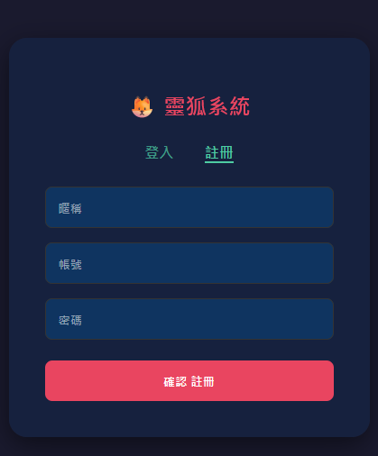
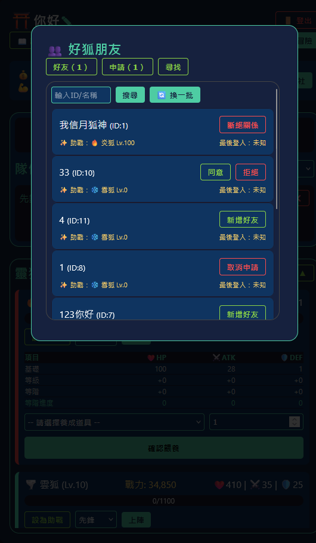
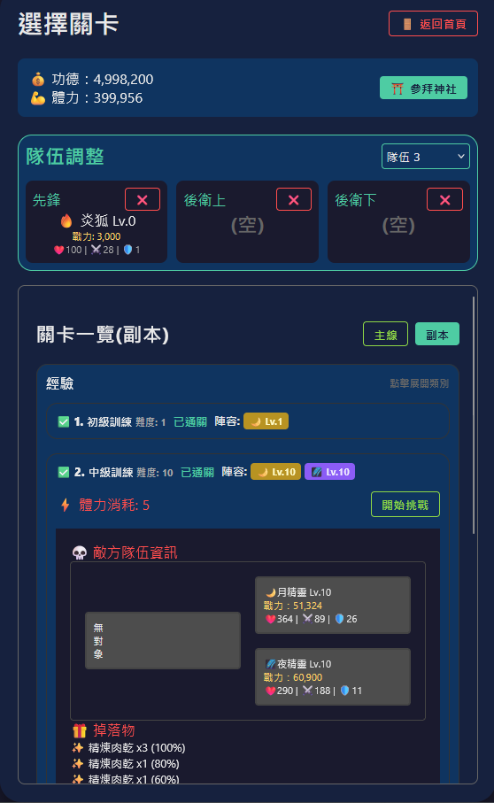
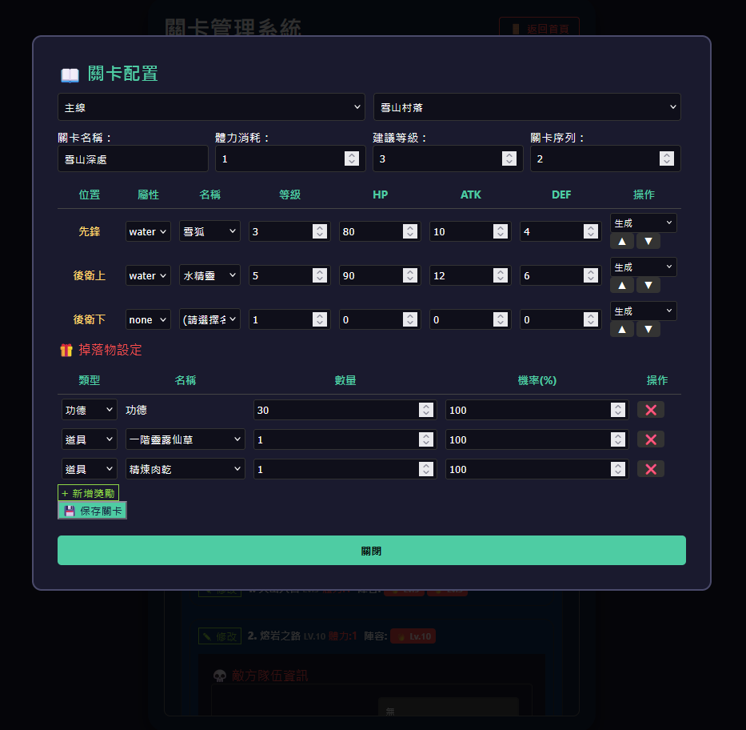
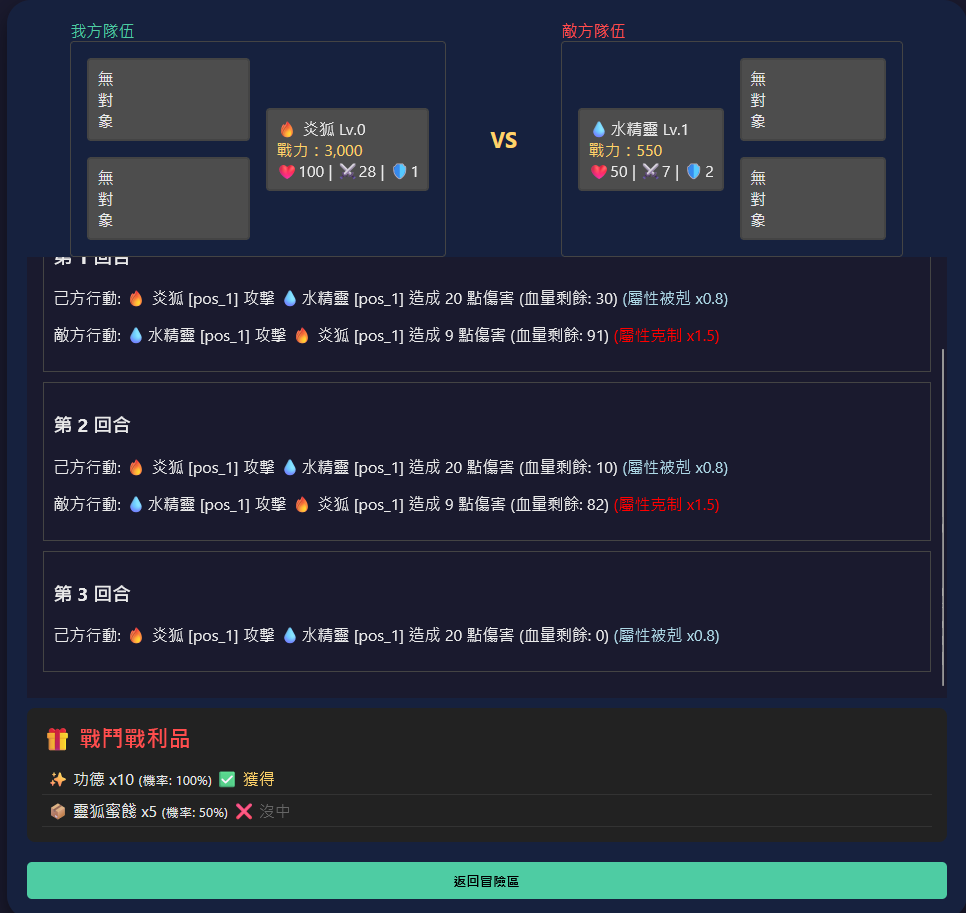
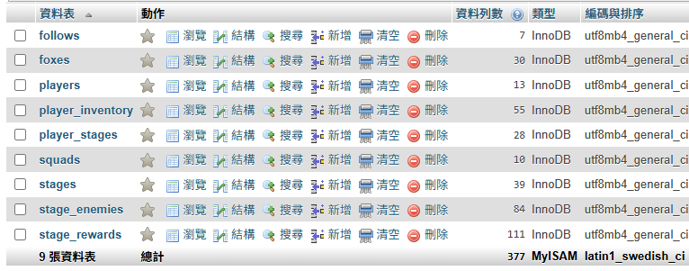

# PHP_MySQL_fox_game
使用PHP連接mySQL製作的網頁小遊戲
-# 選修課程中出於興趣製作的專案
使用 xampp 在本地使用 MySQL 製作

可使用 infinityfree 進行部署(但太久沒用被移除了)

遊戲展示簡單說明：
這是一款輕鬆簡單養成小遊戲，每天登入領取功德與體力，體力用於挑戰每日關卡，功德可前往商店購買養成道具。並含有簡易的好友助戰功能，一起挑戰關卡。由於心力問題，許多部份僅簡略做出雛型。

(1-註冊登入/2-首頁/3-冒險關卡/4-管理員設定關卡/5-關卡結算/6-SQL資料表)

